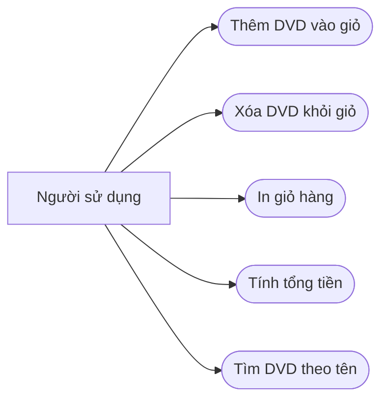

# AIMS-mini - Use cases

Actor: người sử dụng ứng dụng dòng lệnh.

| Use case | Điều kiện / kết quả |
| --- | --- |
| Thêm DVD | Giỏ dưới 20 DVD: thêm và trả True. Đã đủ 20: giữ nguyên giỏ và trả False. |
| Xóa DVD | Có DVD: xóa một lần xuất hiện và trả True. Không có: trả False. |
| In giỏ | Có DVD: đánh số từ 1, in thông tin DVD và tổng tiền. Trống: `The cart is empty`. |
| Tính tổng | Cộng giá các DVD; giỏ rỗng có tổng 0. Tiền hiển thị hai chữ số thập phân. |
| Tìm tên | Trả danh sách DVD có tên chứa từ khóa, theo thứ tự đầu vào. |

## Phần mở rộng từ Lab 03-05

- Giảm giá: phần trăm trong [0, 100], trả tổng sau giảm, ngoài khoảng báo ValueError.
- Sắp xếp giỏ: theo tên (không phân biệt hoa thường) hoặc theo giá tăng dần;
  thao tác thay đổi thứ tự trong giỏ, giữ nguyên các DVD và tổng tiền.
- Tìm category: khớp toàn bộ category, không phân biệt hoa thường;
  không thay đổi danh sách đầu vào.
- Từ hotfix 1.0.1, tìm tên không phân biệt hoa thường; từ khóa rỗng
  khớp mọi tên, không có kết quả trả danh sách rỗng.
